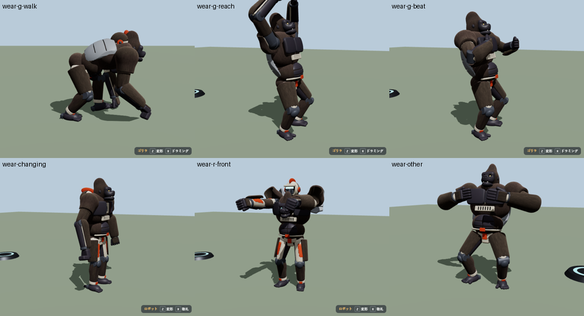

# 例：変形ゴリラロボに乗り移る

村人Aの変身を、別のアイテム「変形ゴリラロボ（仮）」（XRift のアイテム `482340e2-9aef-459a-b0c0-7ecd759c6ae4`、版2、content hash `5b459f3ea2d1`、2026-11-19）へ移した記録です。手順は [../../docs/porting.md](../../docs/porting.md) にあります。

このフォルダーには、ゴリラロボのうち変身にかかわるファイルだけを置いています。体の形（GLB と、それを作る `making/`）や音は入っていないので、このフォルダーだけでは動きません。土台（`src/henshin/reader.ts`・`abilities.ts`・`src/pose-lib/`）は、このリポジトリの `src/` にあるものと同じです。

上段は左から、歩くと四つ足で歩く・両手を上げると立ち上がって手を追う・X でドラミング。下段は左から、Z で変形・ロボットは自分の姿勢をまねる・他の人が乗り移ったゴリラ。

## ファイル

| ファイル | 中身 |
|---|---|
| `src/wear.ts` | この体の動かし方（`BeastBody`）。ゴリラは足元の速さ・向き、頭の向き、手の高さを読んで、ゴリラの動きを操る。ロボットは骨から姿勢を作る |
| `src/beast/actor.ts` | ゴリラロボの動き方。乗り移られている間の `drive()` を足した（普段の `update()` の代わり）。頭を隠す `setHeadsHidden()`、出たあと元に戻る `placeAt()` |
| `src/beast/motions.ts` | ゴリラロボの動き。`gReach`（後ろ足で立って、着ている人の手を追う）を足した |
| `src/beast/rig.ts` | 姿勢の数字から部品の置き方を決める部分（変更なし。`wear.ts` が読む） |
| `src/Item.tsx` | 前の台（乗り移る・出る）、誰が乗り移っているかの共有、キー（Z 変形・X ドラミング／敬礼、VR は B・Y）、部屋への共有、画面の右下の案内 |
| `src/words.ts` | 画面に出る言葉 |
| `scripts/wear-look.mjs`・`fp-look.mjs` | 確認ページで乗り移らせて撮る、一人称で撮る |

## 工夫したこと

### ゴリラには骨を写さない

人の形でない体に人の骨をそのまま写すと、2本足で背筋を伸ばして歩くゴリラになります。ゴリラの体は、もともと持っている動き（四つ足の歩き、座る、立ち上がる、ドラミング）を、人がしたいことで操るようにしました。

| 自分がすること | 読むもの | ゴリラの動き |
|---|---|---|
| 歩く・走る | 足元の位置の変化（速さと向き） | 進む向きに、こぶしをついて歩く。自然な速さ（0.8 m/s）までは歩幅が伸び、それより速いと足が速くなる |
| 止まる | 速さ | 四つ足で構える。6 秒たつと座る |
| 見回す | 頭の骨の向き | 頭がそちらを向く |
| 両手を目より上に上げる | 手の骨の高さ | 後ろ足で立ち上がり（`gReach`）、腕がその手を追う。手の位置は胸から見た位置を、ゴリラの腕の長さに合わせる |

ゴリラは進む向きに体を向けます（動物は横歩きしない）。止まっているときは、着ている人の腰の向きに合わせます。

### ロボットには骨を写す

ロボットは人の形なので、骨から姿勢を作ります。ロボットの体は、手首と足首の行き先から腕と脚を解く作り（IK）なので、村人Aより簡単でした。

- 骨盤・背骨・頭：体の軸どうしの相対回転を角度にする（背骨は腹と胸に半分ずつ）
- 手首・足首：着ている人の肩から手首（股から足首）までを、ロボットの腕（脚）の長さに合わせて、ロボットの肩（股）から置く
- ひじ・ひざ：着ている人のひじ（ひざ）が出ている向き
- 腰の高さ：着ている人の腰が、休みの姿勢からどれだけ下がったかの割合

### 一人称

一人称のカメラは本体がアバターの目に置くので、アイテムからは動かせません。

- ロボット：本人の一人称だけ、目の高さに合わせて縮める
- ゴリラ：頭が低く前にあるので、大きさはそのままにして、頭がカメラの真下に来るよう体を後ろへずらす。見下ろすと、乗っているように肩と背中が見える
- どちらも本人の一人称では頭を描かない（鏡には映す）

### はまった所

1 フレームが 2 回描かれると、2 回目は動いた量が 0 なので、ゴリラの向きが 0 に戻った。速さと向きは、時刻が進んだときだけ更新する。

## 確かめたこと（手元）

確認ページ `?lab&wear`（マネキン2体）で、ゴリラロボの確認スクリプト `node scripts/capture.mjs wear` の 23 項目。台で乗り移る・出る、止まる・座る、歩く向きと速さ、手を上げて立つ、ドラミング、一人称の頭、変形、ロボットの腕、ロボットの一人称の大きさ、敬礼、他の人が乗り移ったとき。全体で 56 項目が通過し、公式チェックは 28 ファイル APPROVE。

## 本番で確かめること（未確認）

- 台で乗り移れる。自分の画面と他の人の画面の両方で、アバターが消えてゴリラロボが動く
- 走ったとき、ゴリラの足が速さに合って見えるか
- VR で両手を上げたとき、立ち上がるか
- Z・X のキーと、VR の B・Y ボタンが届くか
- 一人称の見え方、鏡
